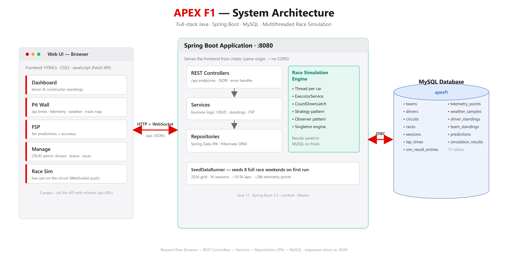

# 🏎️ APEX F1

**A full-stack Java platform for Formula 1 championship management, telemetry analysis, fan predictions, and a concurrent multithreaded race simulation.**

A single **Spring Boot** application serves both the web frontend and a REST API on one port (`http://localhost:8080`), backed by a **MySQL** database. Built for the *Advanced Object-Oriented Programming in Java* course.

---

## ✨ Features

- **Championship Dashboard** — live driver & constructor standings with headshots and team logos.
- **Pit Wall** — lap times, telemetry, weather, and track maps per race session.
- **FSP (Fan Season Predictions)** — submit/edit/delete pole & winner picks with accuracy scoring.
- **Manage** — full **CRUD** admin for drivers, teams, and races.
- **Race Simulation Engine** — a **multithreaded** race simulator (one thread per car) exposed via REST.

---

## 🧰 Technology Stack

**Java 17 · Spring Boot 3.3 (Spring Web MVC) · Spring Data JPA + Hibernate · MySQL 8 · java.util.concurrent (multithreading) · Lombok · Maven · HTML5 / CSS3 / JavaScript (Fetch API)**

| Layer | Technology |
|---|---|
| Language | Java 17 (LTS) |
| Framework | Spring Boot 3.3 (Spring Web MVC) |
| Persistence | Spring Data JPA + Hibernate |
| Database | MySQL 8 |
| Concurrency | `java.util.concurrent` (thread pool, latches, concurrent collections) |
| Boilerplate | Lombok |
| Build | Maven |
| Frontend | HTML5 · CSS3 · JavaScript (Fetch API) |

> Not used: WebSockets and Bootstrap (planned / intentionally custom CSS).

---

## 🏗️ Architecture

The frontend is served from `src/main/resources/static/`, so it runs on the **same origin** as the API — no CORS, one deployable app.

**Request flow:** `Browser → REST Controllers → Services → Repositories (JPA) → MySQL`, with JSON responses rendered by JavaScript.



---

## 🚀 Getting Started

### Prerequisites
- **JDK 17**
- **Maven**
- **MySQL 8** running on port 3306

### 1. Configure the database
In `src/main/resources/application.properties`, set your MySQL password:
```properties
spring.datasource.username=root
spring.datasource.password=YOUR_PASSWORD
```
The `apexf1` database, all tables, and the full dataset are created automatically on first run.

### 2. Run it

**VS Code:** open the folder → install the Java + Spring Boot extensions → run `BackendApplication.java`.

**Command line:**
```bash
mvn spring-boot:run
```

Then open **http://localhost:8080**.

*(A manual SQL script is also provided at `database/apexf1.sql`.)*

---

## 🗄️ Database

**11 entities / tables:** `Team`, `Driver`, `Circuit`, `Race`, `Session`, `LapTime`, `TelemetryPoint`, `WeatherSample`, `DriverStanding`, `TeamStanding`, `Prediction`.

- Relationships via `@ManyToOne` (e.g. many drivers → one team).
- Primary keys: `@GeneratedValue(strategy = IDENTITY)`.
- Enums stored as strings (`@Enumerated(EnumType.STRING)`).
- Seeded on first run by `SeedDataRunner`: **11 teams, 22 drivers, 8 circuits, 8 races**, standings, and Spanish GP session data.

---

## 🔌 REST API

| Method | Path | Purpose |
|---|---|---|
| GET | `/api/standings/drivers` · `/teams` | Championship standings |
| GET/POST/PUT/DELETE | `/api/drivers` · `/api/teams` · `/api/races` | Full CRUD |
| GET | `/api/races/{id}/sessions` | Sessions in a race weekend |
| GET | `/api/sessions/{id}/laptimes` · `/telemetry` · `/weather` | Pit Wall data |
| GET/POST/PUT/DELETE | `/api/predictions/race/{id}` (+ `/score`) | Fan predictions |
| POST | `/api/simulations/race/{id}` | Start a race simulation |
| GET | `/api/simulations/{id}` | Live simulation snapshot |

---

## 🧵 Race Simulation Engine

A multithreaded simulator in `com.apexf1.backend.simulation`:

- **One thread per car** via an `ExecutorService`; each advances every ~100 ms.
- Coordinated with a `CountDownLatch`; state shared safely via `ConcurrentHashMap`, `CopyOnWriteArrayList`, `volatile` / `synchronized`.
- **Design patterns:** Strategy (`PaceStrategy`), Observer (`TelemetryObserver`), Singleton (`SimulationEngine`).

```bash
# start a 5-lap simulation of race 5, sped up 30x
curl -X POST "http://localhost:8080/api/simulations/race/5?laps=5&timeScale=30"
# then poll the live snapshot
curl "http://localhost:8080/api/simulations/1001"
```

---

## 📁 Project Structure

```
apex-f1/
├── pom.xml, run.bat
├── database/apexf1.sql            # full schema + data
├── docs/                          # status doc, viva guide, architecture diagram
└── src/main/
    ├── java/com/apexf1/backend/
    │   ├── config controller dto model repository service seed
    │   └── simulation             # multithreaded engine
    └── resources/
        ├── application.properties
        └── static/                # frontend: HTML/CSS/JS + img/
```

---

## 📌 Status & Roadmap

**Done:** full-stack app, CRUD REST API, MySQL + JPA with full dataset, 4 frontend pages, multithreaded simulation engine.

**Planned (weeks 7–8):** WebSocket live telemetry, real-time Pit Wall dashboard, persisting simulation results to MySQL, JUnit tests, and deployment packaging.

---

## 👥 Team

| Member | Responsibility |
|---|---|
| **PIYUSH** | Database & Backend |
| **AKSHAY** | Simulation Engine |
| **SHAUN JAESON** | System Architecture |
| **SANJAY ADITHYA** | Frontend & Visualization |

---

## ❓ Why Java 17 (not a newer JDK)?

Java 17 is the current **LTS** release and the officially supported baseline for **Spring Boot 3.3** and **Lombok**. Newer JDKs (e.g. 25/26) are outside that tested matrix and broke the Lombok build, so the project is pinned to Java 17 for stability and reproducibility.
